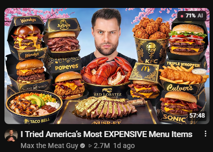
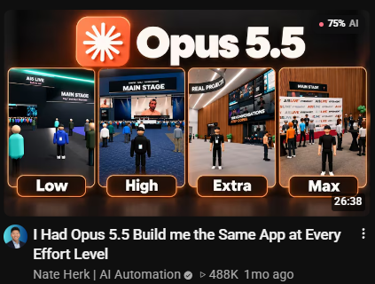
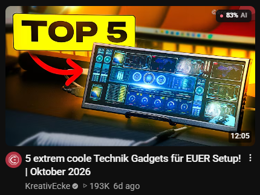
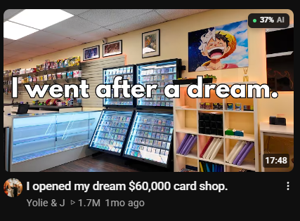

# YouTube Thumbnail AI Classifier

**AI-likelihood scores, directly in your YouTube feed.**

A local Chrome extension that analyzes thumbnails as you browse and shows a compact score before you click. A score is an estimate, not proof. The model was trained on Tiny-GenImage rather than YouTube thumbnails, so treat the result as a signal not a verdict.

## See it in action

<table>
  <tr>
    <td width="50%"></td>
    <td width="50%"></td>
  </tr>
  <tr>
    <td width="50%"></td>
    <td width="50%"></td>
  </tr>
</table>

The extension finds new thumbnails automatically, displays an accessible loading state, and replaces it with a color-coded score: 🟢 0–39%, 🟡 40–69%, or 🔴 70–100%.

## Quick start

**Requirements:** Python 3.10+, Git, internet access for the first download, and Chrome, Brave, Edge, or another Chromium browser. No API key or GPU is required.

```bash
git clone https://github.com/naiylo/youtube-thumbnail-classifier.git
cd youtube-thumbnail-classifier
```

Create and activate a virtual environment:

```powershell
# Windows PowerShell
python -m venv .venv
.\.venv\Scripts\Activate.ps1
```

```bash
# macOS/Linux
python3 -m venv .venv
source .venv/bin/activate
```

Install the dependencies and start the local backend:

```bash
python -m pip install --upgrade pip
python -m pip install fastapi "uvicorn[standard]" httpx pillow torch transformers scikit-learn joblib
python -m uvicorn backend.main:app --host 127.0.0.1 --port 8000
```

Keep the terminal open. The first launch downloads CLIP from Hugging Face; later launches use the cache. You can verify the API at [127.0.0.1:8000/docs](http://127.0.0.1:8000/docs).

Then open your browser's extensions page, enable **Developer mode**, choose **Load unpacked**, and select this repository's `extension` folder. Open or refresh [YouTube](https://www.youtube.com/).

## How it works

```text
YouTube thumbnail → extension → local FastAPI server
→ CLIP ViT-B/32 embedding → logistic regression → on-card score
```

The extension sends the thumbnail URL to `127.0.0.1`. The local backend accepts only HTTPS images from `i.ytimg.com`, limits downloads to 5 MiB, fetches the image, and returns a score from 0 to 100. No third-party classification API is used.

```text
backend/    API, URL validation, and inference
extension/  Manifest V3 extension and badge UI
models/     Trained logistic-regression model
training/   Dataset, embedding, training, and test scripts
data/       Local training artifacts
```

## Troubleshooting

| Problem | Fix |
|:--|:--|
| `Unavailable` badge | Confirm the backend and `/docs` are running, then refresh YouTube. |
| Missing Python module | Activate `.venv` and repeat the install command. |
| Port 8000 is busy | Stop the conflicting process, or change both Uvicorn's port and `CLASSIFIER_URL`. |
| Extension is missing | Load the `extension` folder—not the repository root—then reload the page. |

## Retraining

The included model is ready to use. To replace it with a model trained on your own data, install `datasets pandas numpy`, then run `prepare_dataset.py`, `split_dataset.py`, `extract_embeddings.py`, and `training_baseline.py` from the `training` folder. The pipeline downloads 2,000 images and overwrites `models/LR_model.joblib`.

## Responsible use

Thumbnails can mix photography, editing, 3D rendering, and generated elements; the score cannot identify which technique was used. Do not use it to accuse creators, determine authorship, or make moderation decisions without other evidence.

Contributions are welcome—especially reproducible bugs and representative thumbnails. Please leave out private browsing data and personally identifying information.
<div align="center"><sub>More context before the click.</sub></div>
